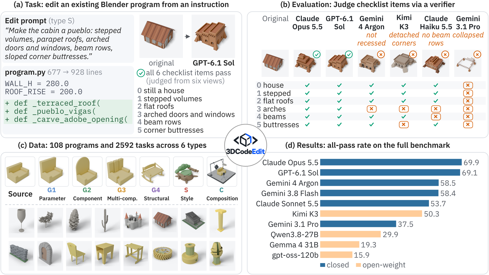

# 3DCodeEdit: Benchmarking Instruction-Guided 3D Program Editing

[Project page](https://binjiew.github.io/3DCodeEdit/) · [Paper](https://arxiv.org/abs/2610.38231) · [Data](https://huggingface.co/datasets/BinjieW/3DCodeEdit)

3DCodeEdit is a benchmark for instruction-guided editing of 3D programs. Each task gives a model a
complete Blender Python program that builds an object entirely in code, together with an edit prompt,
and asks for the full edited program.
We run both programs in Blender, render them from six matched views, and a multimodal verifier
checks the renders against a checklist written for the task.



The benchmark has 2,592 tasks built on 108 source programs from six object categories. 55 programs
come from [3DCodeBench](https://huggingface.co/datasets/YipengGao/3DCode), and we reconstructed the
other 53 from parametric OpenSCAD models shared by designers online. Each program comes with four
prompts for each of six edit types.

## Checklists and edit types

An edit prompt is a short list of instructions. One asks the model to keep the object's identity and the
parts outside the requested edits, and each of the others requests one visible change. The checklist
follows the same structure: one item for each requested change, plus one for preserving the rest. A task
passes only when every item on its checklist passes.

The edit type determines how many changes are requested and how far they reach:

| Type | Name | Edit | Checklist items |
|---|---|---|---|
| G1 | Parameter | Change one visible attribute (size, proportion, spacing, position, or orientation) of one part or part family | 1 + preservation |
| G2 | Component | Reconstruct the form of one part, together with a size change and one further visible change to it | 3 + preservation |
| G3 | Multi-component | Reconstruct and resize two separate parts independently | 4 + preservation |
| G4 | Structural | Reorganize how three or more regions meet, span, or support one another, changing the overall layout | 5 + preservation |
| S | Style | Redesign the object in a different style by reshaping its main body and adding four large, mostly geometric cues | 5 + preservation |
| C | Composition | Place the object in a functional scene with a support surface, three working props, and one large context structure | 5 + preservation |

For style edits, the preservation item asks only that the object's category is still recognizable.
For composition edits, it asks that the original object is still present in the scene.

## Data

```
data/
├── sources.jsonl          one row per source program
├── sources/<source_id>.py the 108 Blender programs
├── tasks.jsonl            one row per task (2,592)
├── analysis_subset.json   the 13 programs / 312 tasks used for the paper's multi-run analyses
├── ATTRIBUTION.csv        upstream origin, author, and license of every source program
└── licenses/              license texts
```

Each row of `tasks.jsonl` looks like this:

| Field | Meaning |
|---|---|
| `case_id` | the task id |
| `source_id` | the source program |
| `category` | the object category |
| `edit_type` | `G1`–`G4`, `S`, or `C` |
| `query_index` | the prompt index (0–3) within the program and edit type |
| `instruction` | the prompt shown to the editor, with instructions separated by semicolons |
| `eval_query` | the prompt shown to the verifier as context |
| `checklist` | the items to judge: `clause` (the instruction it checks), `question` (a yes/no question), and `preservation` (true for the preservation item) |

```json
{"case_id": "3dcodebench_AgaveMonocot_seed0_L1_Q0", "edit_type": "G1",
 "instruction": "Preserve the object's identity and parts outside the requested edits; Stretch the entire rosette vertically so its overall height is conspicuously greater while its footprint diameter remains unchanged.",
 "checklist": [
  {"clause": "Keep the modified result identifiable and visually coherent as a version of the source object while applying the requested edits",
   "question": "Is the modified result still an identifiable and visually coherent version of the source object, without severe corruption of parts not targeted by the requested edits?",
   "preservation": true},
  {"clause": "Stretch the entire rosette vertically so its overall height is conspicuously greater while its footprint diameter remains unchanged.",
   "question": "Is the entire rosette conspicuously taller than the original while retaining the original footprint diameter?",
   "preservation": false}]}
```

We screened every prompt and checklist for ambiguity and rewrote the ones that could be read in more
than one way. The 51 items that remained ambiguous after rewriting are left out of the checklists.
As a result, a few tasks (47) have fewer items than the table above lists.

## Evaluation

Evaluating a model takes two steps:

1. **Run inference.** The model edits the source program of every task.
2. **Render, verify, and score.** This repository renders the edited programs, judges them against the
   checklists, and computes the all-pass rates.

### Setup

Install [Blender 5.1.0](https://www.blender.org/download/) and the Python requirements:

```bash
pip install -r requirements.txt
```

### 1. Run inference

We provide an example inference script that queries an OpenAI-compatible endpoint with the paper's
settings:

```bash
OPENAI_API_KEY=... python -m evaluation.inference --model my-model --out my-model.jsonl
```

You can also run inference in whatever way you prefer, as long as the inputs and outputs follow the same
format. `python -m evaluation.prompts > prompts.jsonl` writes the input of every task as a system prompt
and a user message. Save the outputs to a JSONL file with one line per task, in the following format:

```json
{"case_id": "3dcodebench_AgaveMonocot_seed0_L1_Q0", "response": "<the model's full reply>", "finish_reason": "stop"}
```

| Field | Content |
|---|---|
| `case_id` | the task's id, as in `prompts.jsonl` |
| `response` | the model's full reply. The edited program is extracted from it with the rule used in the paper. If the reply contains Python code blocks, the program is the longest one that compiles. Otherwise, it is the reply itself, without any explanatory lines before or after the code. |
| `finish_reason` | `stop` if the reply finished normally. Any other value, such as `length` for a reply cut off at the output limit, makes the task a failed edit. |

### 2. Render, verify, and score

```bash
RUN=runs/my-model

# Render each original/edited pair from six views
python -m evaluation.render --run $RUN --predictions my-model.jsonl \
    --blender /path/to/blender --workers 32

# Judge every checklist item with Gemini 3.8 Flash
GEMINI_API_KEY=... python -m evaluation.verify --run $RUN --workers 32

# Compute all-pass rates
python -m evaluation.score runs/*
```

Each step saves its results per task and skips tasks that are already done, so you can stop and resume
at any time. To run part of the benchmark, add `--edit-types`, `--categories`, or `--subset analysis`.

Programs get 480 seconds in Blender, and a program that raises an error, times out, or leaves an empty
scene fails its task.

Results are written to `runs/<name>/`: the extracted programs, the renders, the per-item verdicts with
the verifier's evidence, and `score.json`.

## Results

All-pass rate (%) on all 2,592 tasks, the percentage of tasks whose edited program executes, renders, and
passes every checklist item. Each model edits once, at medium reasoning effort or its closest equivalent,
with at most 64,000 output tokens.

| Model | G1 | G2 | G3 | G4 | S | C | All | Exec. |
|---|---:|---:|---:|---:|---:|---:|---:|---:|
| ***Proprietary*** | | | | | | | | |
| Claude Opus 5.5 | **96.5** | **76.9** | 64.4 | 58.6 | 52.5 | **70.8** | **69.9** | **99.3** |
| GPT-6.1-sol | 95.6 | 71.3 | **65.3** | **59.3** | **57.6** | 65.7 | 69.1 | 96.1 |
| Gemini 4 Argon | 94.7 | 67.4 | 54.2 | 41.0 | 41.0 | 53.0 | 58.5 | 95.4 |
| Gemini 3.8 Flash | 94.7 | 68.8 | 62.7 | 53.7 | 34.5 | 36.3 | 58.4 | 92.0 |
| Claude Sonnet 5.5 | 91.4 | 66.4 | 51.2 | 41.9 | 25.9 | 45.4 | 53.7 | 98.8 |
| Claude Haiku 5.5 | 90.3 | 54.4 | 42.8 | 31.5 | 16.0 | 32.9 | 44.6 | 94.3 |
| GPT-6-luna | 87.0 | 51.4 | 36.6 | 29.4 | 18.8 | 26.9 | 41.7 | 92.4 |
| Gemini 3.1 Pro | 88.7 | 50.9 | 41.0 | 28.0 | 7.9 | 8.3 | 37.5 | 96.4 |
| Claude Haiku 4.5 | 81.5 | 28.9 | 9.3 | 4.4 | 0.0 | 0.0 | 20.7 | 91.6 |
| ***Open-weight*** | | | | | | | | |
| Kimi K3 | 88.2 | 57.9 | 47.5 | 38.9 | 27.3 | 42.4 | 50.3 | 96.5 |
| Qwen3.8-27B | 84.3 | 44.2 | 28.5 | 17.1 | 3.5 | 1.6 | 29.9 | 89.3 |
| Qwen3.6-27B | 80.8 | 29.6 | 16.0 | 6.0 | 0.2 | 0.0 | 22.1 | 81.8 |
| Gemma 4 31B | 77.5 | 21.5 | 11.8 | 4.9 | 0.2 | 0.0 | 19.3 | 86.2 |
| Qwen3.6-35B-A3B | 70.6 | 18.8 | 5.3 | 1.2 | 0.0 | 0.0 | 16.0 | 72.7 |
| gpt-oss-120b | 71.5 | 18.1 | 4.4 | 1.6 | 0.0 | 0.0 | 15.9 | 77.3 |
| Qwen3-VL-235B-A22B | 61.8 | 9.0 | 2.3 | 0.5 | 0.0 | 0.0 | 12.3 | 68.4 |
| Qwen3-Coder-Next | 54.2 | 4.9 | 1.4 | 0.2 | 0.0 | 0.0 | 10.1 | 51.1 |
| *Average* | *82.9* | *43.5* | *32.0* | *24.6* | *16.8* | *22.5* | *37.1* | *87.0* |

Exec. is the share of edited programs that execute and render. Average is the mean over the 17 models.

<details>
<summary>Five Qwen3.5 models (2B–35B)</summary>

| Model | G1 | G2 | G3 | G4 | S | C | All | Exec. |
|---|---:|---:|---:|---:|---:|---:|---:|---:|
| Qwen3.5-27B | 78.5 | 20.6 | 8.1 | 1.9 | 0.0 | 0.0 | 18.2 | 68.6 |
| Qwen3.5-35B-A3B | 68.3 | 7.6 | 2.8 | 0.0 | 0.0 | 0.0 | 13.1 | 63.9 |
| Qwen3.5-9B | 55.3 | 3.0 | 1.4 | 0.2 | 0.0 | 0.0 | 10.0 | 47.1 |
| Qwen3.5-4B | 48.8 | 0.9 | 0.0 | 0.0 | 0.0 | 0.0 | 8.3 | 38.8 |
| Qwen3.5-2B | 2.1 | 0.0 | 0.0 | 0.0 | 0.0 | 0.0 | 0.3 | 15.8 |

</details>

## License

The code is released under the MIT license, and the edit prompts and checklists under CC BY 4.0. Each
source program keeps the license of the model it comes from, listed with its author and attribution in
`data/ATTRIBUTION.csv`. Programs under non-commercial licenses may be used only for non-commercial purposes.

## Citation

```bibtex
@article{wang20263dcodeedit,
  title   = {{3DCodeEdit}: Benchmarking Instruction-Guided {3D} Program Editing},
  author  = {Wang, Binjie and Zhao, Xinran and Yu, Shoubin and Li, Xiang and Yong, Silong and
             Yang, Chenyang and Chen, Tianyu and Du, Ruofei and He, He and Zhao, Chen and Wu, Tongshuang},
  journal = {arXiv preprint arXiv:2610.38231},
  year    = {2026}
}
```
